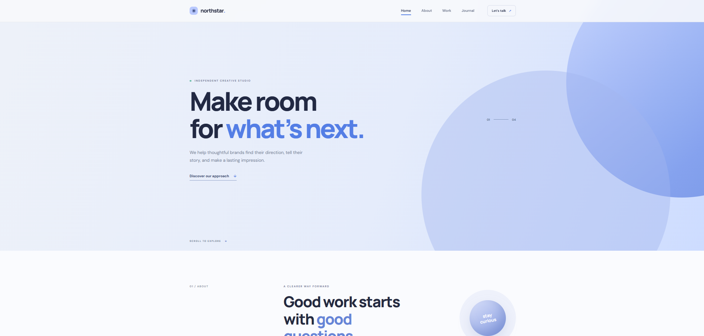
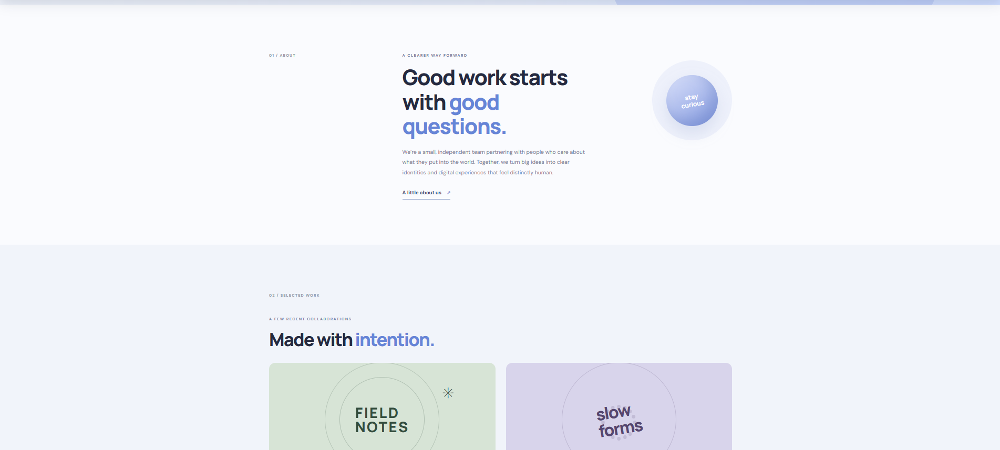
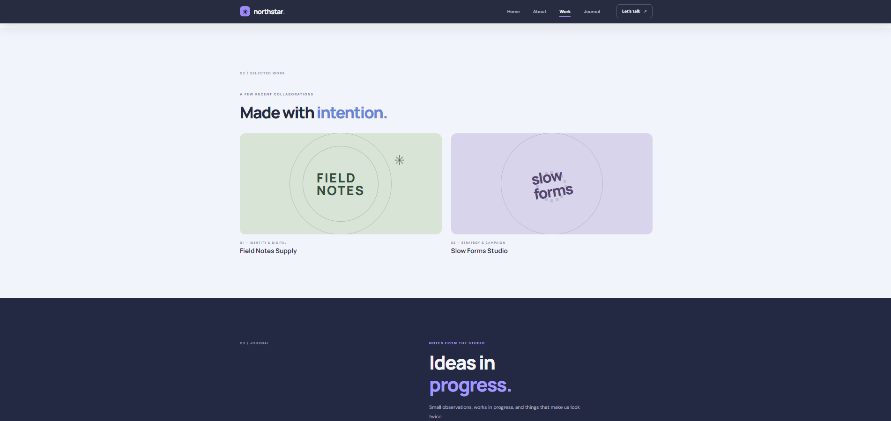
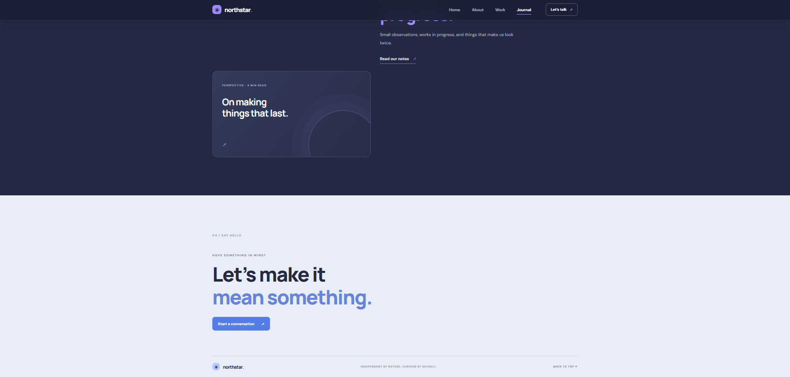

# Northstar — Creative Studio Website

A responsive, single-page website concept for **Northstar**, an independent creative studio. The page introduces the studio, presents selected work, shares a journal feature, and provides a contact link.

## Preview

The screenshots below show the website at different scroll positions:

### Home and About


### About and Selected Work


### Selected Work and Journal


### Journal and Contact


## Project structure

```text
Northstar-Project/
├── index.html
├── styles.css
├── app.js
├── README.md
└── assets/
    ├── 01-home-about.png
    ├── 02-about-work.png
    ├── 03-work-journal.png
    └── 04-journal-contact.png
```

## Built with

- **HTML5** — page structure and content
- **CSS3** — layout, styling, responsive design, and visual effects
- **JavaScript** — mobile navigation, navbar scroll styling, and active-section navigation
- **Google Fonts** — DM Sans and Manrope

## Features

- Responsive navigation with a mobile menu
- Fixed navigation bar that changes appearance while scrolling
- Smooth scrolling between page sections
- Active navigation link updates as the visitor scrolls
- Home, About, Selected Work, Journal, and Contact sections
- Contact link opens the visitor's default email application

## Run locally with XAMPP

This is a **static frontend project**. PHP and MySQL are not required.

1. Install and open [XAMPP](https://www.apachefriends.org/).
2. Start **Apache** from the XAMPP Control Panel.
3. Copy the complete `Northstar-Project` folder into XAMPP's `htdocs` directory.
   - Windows example: `C:\xampp\htdocs\Northstar-Project\`
4. Open this address in your browser:

   `http://localhost/Northstar-Project/`

You can also open `index.html` directly in a browser, but using Apache through XAMPP is useful for testing it as a local website.

## Notes

- Keep `index.html`, `styles.css`, and `app.js` together in the project root so the stylesheet and script paths continue to work.
- The page imports Google Fonts from Google Fonts, so an internet connection is needed to load those fonts. System fallback fonts will be used if they are unavailable.
- The contact button uses the `mailto:` link `hello@northstar.studio`. Update this address in `index.html` if you want to use a different email address.

## License

No license has been specified for this project. Add a license file if you plan to distribute or reuse it publicly.
